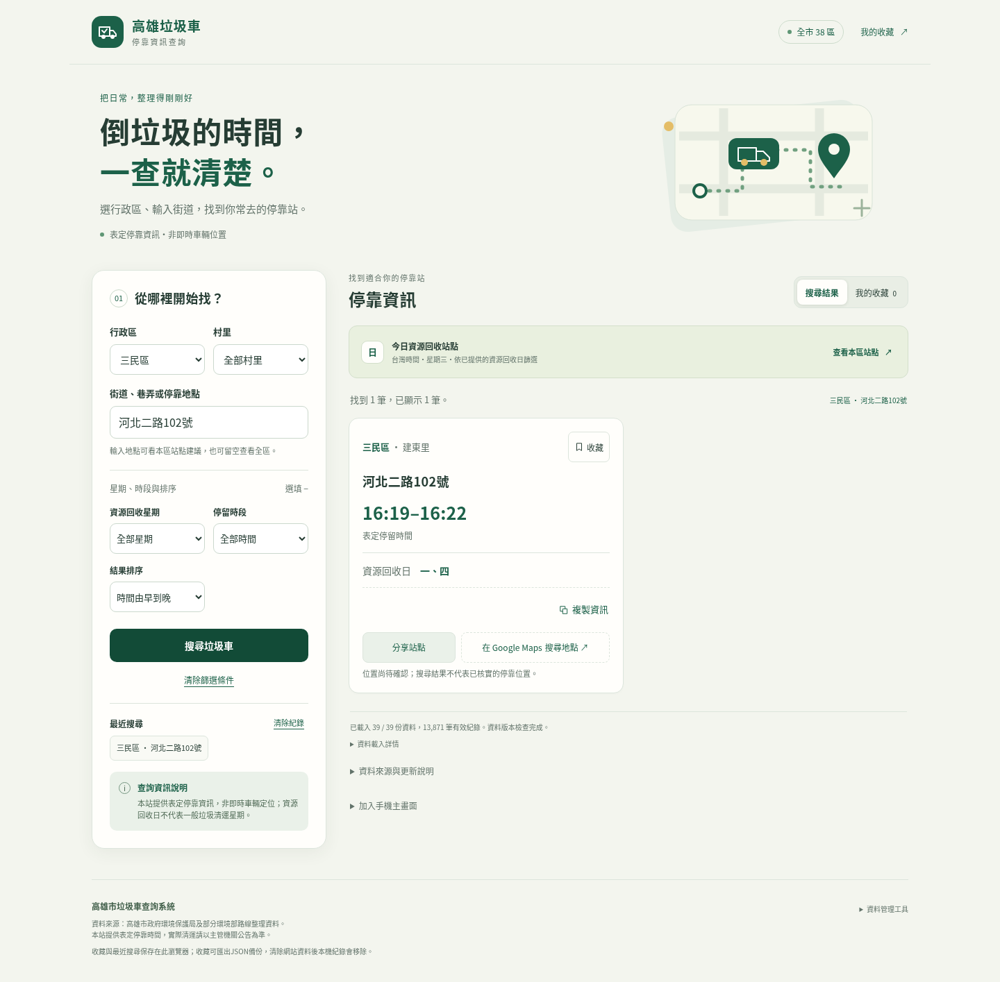

# 搜尋與收藏操作教學

新版支援[全市搜尋、大字模式、收藏名稱與置頂及問題回報](public-convenience-guide.md)，以下單區與回收星期操作仍適用。

新增的站點分享、導航、收藏JSON備份與主畫面功能，請參閱[民眾便利功能教學](convenience-guide.md)。

首頁只顯示垃圾車停靠地點、表定停留時間與資源回收日。本站提供表定停靠資訊，非即時車輛定位；資源回收日不代表一般垃圾清運星期。

## 找停靠站

1. 選擇行政區；知道村里時可以再選村里。沒有村里資料的站點仍可用地點搜尋。
2. 輸入街道、巷弄或地點的一部分。建議清單來自已選行政區及村里的實際站點，最多 8 個；也可以留空查看全區。
3. 如有需要，展開「星期、時段與排序」，選「資源回收星期」、停留時段及排序。不選星期會保留未提供回收日的站點；選星期時，僅列入原始資料明確符合該回收星期的站點。
4. 按「搜尋垃圾車」，也可在地點欄按 Enter。手機會直接移到結果；每次顯示 30 筆，底部「顯示更多」繼續載入畫面，不必重新下載 CSV。

卡片上方顯示行政區、村里與地點；綠色大字是原有資料的表定時間。只有單一到點時間的資料會註明未提供離站時間。無法完整解析的時間保留原文並標示待確認，不參與時段篩選。

每張卡片只顯示資源回收日；缺值顯示「資源回收日尚未提供」，表示來源沒有該欄資料，不代表沒有垃圾車。沒有結果時，可直接按「清除條件，查看本區」。左側「清除篩選條件」保留目前行政區，清除其餘條件。

## 今日資源回收站點

在「今日資源回收站點」按「查看本區站點」，系統依 **Asia/Taipei 台灣時間**套用今天的資源回收星期，保留行政區，清除村里、關鍵字及時段，排序改由早到晚。

只有原有資料明確提供今天資源回收日的站點才會出現，不使用歷史的一般垃圾日期規則。這不表示今天一定有一般垃圾清運，也不表示車輛已到站或即將到站；實際清運以主管機關公告為準。沒有結果或沒有回收日資料，都不代表當天沒有垃圾車。

## 收藏、最近搜尋與複製

- 按卡片「收藏」，變成「已收藏」；再按一次可取消。頁首也有「我的收藏」捷徑，不必先捲過搜尋表單；收藏畫面顯示所有行政區，不套用搜尋面板的篩選。最多保存 200 個站點。
- 收藏依來源檔案、行政區、責任區、車次、地點與完整時間區分，不會把同地點的其他班次一起收藏。收藏保存識別及可選的個人名稱／置頂；回收日每次重新從 CSV 取得。若檔案失敗或識別已變更，會保留原收藏並提示尚未顯示，不會顯示舊日期副本。
- 最近搜尋保留 6 組不同條件。按紀錄可以恢復行政區、村里、關鍵字、資源回收星期、時段及排序。若新版資料已沒有原村里，會要求重新選擇，不會悄悄擴大搜尋。
- 舊紀錄若保存一般垃圾星期，按下後會顯示「舊搜尋的星期條件已不再提供，未套用原星期」，保留其他條件、清空星期並聚焦「資源回收星期」。請自行重新選擇；原條件不會悄悄轉成回收星期，收藏與原紀錄不因此刪除。只有重新提交搜尋才儲存新回收條件。
- 「清除紀錄」只清除最近搜尋，不影響收藏。收藏與紀錄只在目前瀏覽器保存，無帳號同步；清除網站資料會移除它們。瀏覽器禁止保存或空間不足時，頁面會提示，仍可使用本次頁面的收藏與搜尋。
- 「複製資訊」會複製地點、行政區／村里、表定時間與資源回收日，不包含一般垃圾日。若瀏覽器不允許自動複製，會開啟文字視窗，請長按或選取複製，按「完成」關閉。

## 載入失敗時

結果下方顯示載入狀態。「資料載入詳情」列出失敗的檔案、資料版本狀態與合併顯示的重複列數。部分路線失敗時，其他已載入區域仍可查詢；受影響行政區另有資料不完整提示。

按「重試載入失敗資料」，只重新下載失敗檔案，保留收藏及最近搜尋，也不會把成功資料重複加入。全部失敗時顯示網路錯誤與重試按鈕，而不是宣稱沒有站點。每份檔案有 12 秒逾時；恢復網路後可再次重試。

## 目前畫面

本版延續綠色與暖白色設計，只簡化星期資訊。以下截圖使用同一個真實站點，並非官方資料更新。



[手機版畫面](screenshots/recycling-mobile.png)。舊版截圖保留於repository歷史，不作為目前操作說明。

## 驗證方式

```sh
npm ci --ignore-scripts
npm test
npm run audit
npm run reconcile:sanmin-west
npx playwright install --with-deps chromium
npm run test:browser
```

本機已有 Chromium 時可使用：

```sh
PLAYWRIGHT_CHROMIUM_EXECUTABLE_PATH=/usr/bin/chromium npm run test:browser
```

首頁測試讀取實際的 39 份 CSV 及 243 條規則，並驗證全部 38 區。手機測試使用 Chromium 觸控模擬，寬度 320／390px；平板為 768px。這是瀏覽器模擬測試，未宣稱已在實體 iPhone 或 Android 手機上測試。
