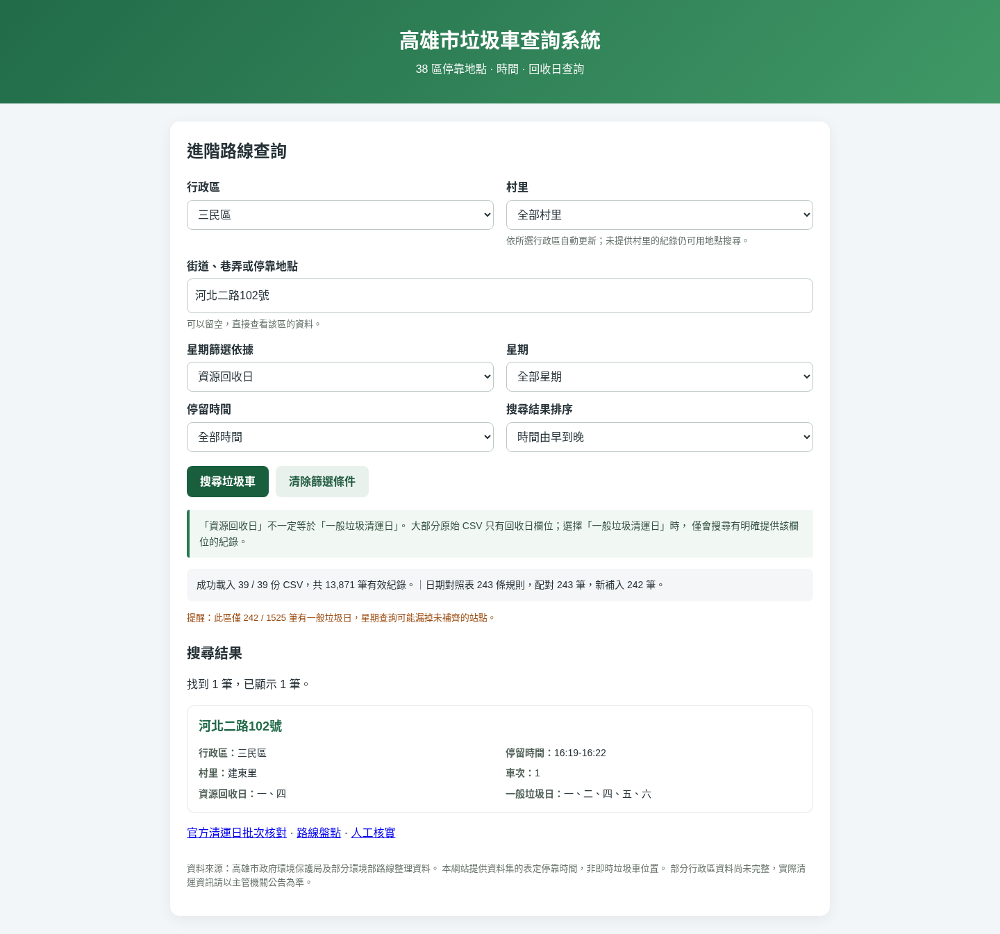
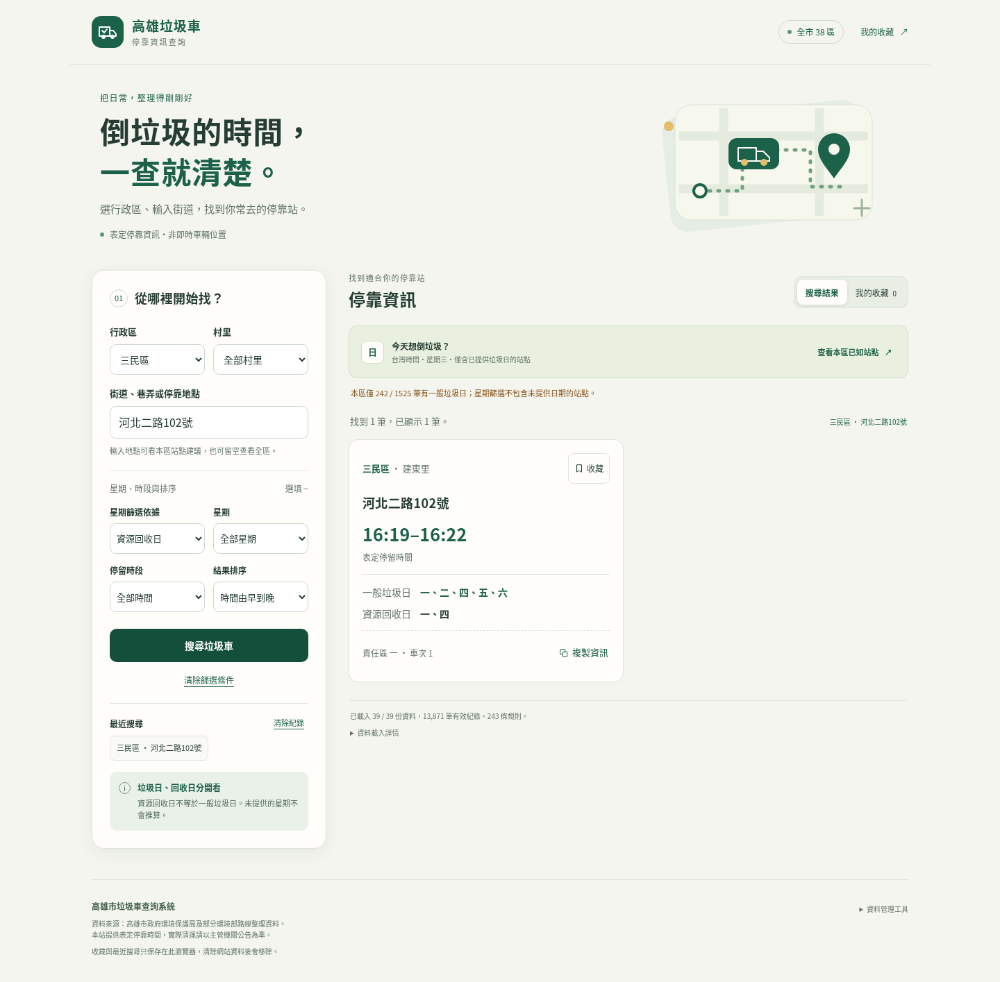

# 搜尋與收藏操作教學

首頁是民眾使用的表定停靠查詢。它沒有即時車輛位置，也不會依回收日推算垃圾日。

## 找停靠站

1. 選擇行政區；知道村里時可以再選村里。沒有村里資料的站點仍可用地點搜尋。
2. 輸入街道、巷弄或地點的一部分。建議清單來自已選行政區及村里的實際站點，最多 8 個；也可以留空查看全區。
3. 如有需要，展開「星期、時段與排序」。先選星期篩選依據：一般垃圾清運日或資源回收日，再選星期。只選清運類型、不選星期，仍會顯示未提供日期的站點，方便查看時間。
4. 按「搜尋垃圾車」，也可在地點欄按 Enter。手機會直接移到結果；每次顯示 30 筆，底部「顯示更多」繼續載入畫面，不必重新下載 CSV。

卡片上方顯示行政區、村里與地點；綠色大字是原有資料的表定時間。只有單一到點時間的資料會註明未提供離站時間。無法完整解析的時間保留原文並標示待確認，不參與時段篩選。

一般垃圾日與資源回收日分列；「尚未提供」表示沒有該欄資料，不代表不清運。沒有結果時，可直接按「清除條件，查看本區」。左側「清除篩選條件」保留目前行政區，清除其餘條件。

## 今天有沒有已知站點？

按「查看本區已知站點」，系統依 **Asia/Taipei 台灣時間**查詢今天的一般垃圾星期，保留行政區，清除村里、關鍵字及時段，排序改由早到晚。

只有原有資料已明確提供一般垃圾星期、且符合今天的站點才會出現。結果是表定資料，不代表車輛已到站、即將到站或臨時調度後仍準時。沒有結果時，系統不會改用回收日；會提示資料不足的可能性。這不表示當天沒有垃圾車。

## 收藏、最近搜尋與複製

- 按卡片「收藏」，變成「已收藏」；再按一次可取消。頁首也有「我的收藏」捷徑，不必先捲過搜尋表單；收藏畫面顯示所有行政區，不套用搜尋面板的篩選。最多保存 200 個站點。
- 收藏依來源檔案、行政區、責任區、車次、地點與完整時間區分，不會把同地點的其他班次一起收藏。收藏僅存識別；日期每次重新從 CSV 取得。若檔案失敗或識別已變更，會保留原收藏並提示尚未顯示，不會顯示舊日期副本。
- 最近搜尋保留 6 組不同條件。按紀錄可以恢復行政區、村里、關鍵字、星期依據、星期、時段及排序。若新版資料已沒有原村里，會要求重新選擇，不會悄悄擴大搜尋。
- 「清除紀錄」只清除最近搜尋，不影響收藏。收藏與紀錄只在目前瀏覽器保存，無帳號同步；清除網站資料會移除它們。瀏覽器禁止保存或空間不足時，頁面會提示，仍可使用本次頁面的收藏與搜尋。
- 「複製資訊」會複製地點、行政區／村里、時間及分開的垃圾日／回收日。若瀏覽器不允許自動複製，會開啟文字視窗，請長按或選取複製，按「完成」關閉。

## 載入失敗時

結果下方顯示載入狀態。「資料載入詳情」列出失敗的檔案、日期表狀態與合併顯示的重複列數。部分路線失敗時，其他已載入區域仍可查詢；受影響行政區另有資料不完整提示。

按「重試載入失敗資料」，只重新下載失敗檔案，保留收藏及最近搜尋，也不會把成功資料重複加入。全部失敗時顯示網路錯誤與重試按鈕，而不是宣稱沒有站點。每份檔案有 12 秒逾時；恢復網路後可再次重試。

## 改版前後

| 項目 | 原首頁 | 新首頁 |
| --- | --- | --- |
| 版面 | 搜尋與結果上下排列 | 電腦左右分欄，手機單欄，搜尋後直達結果 |
| 尋找地點 | 自行輸入關鍵字 | 真實站點建議、最近搜尋恢復 |
| 結果 | 同等字級的多欄文字 | 大字時間、地點與村里、分開的日期及缺值提示 |
| 常用資訊 | 每次重新搜尋 | 本機收藏、複製與手動複製降級 |
| 今日查詢 | 手動選一般垃圾及星期 | 台灣日期快捷查詢，未提供垃圾星期不納入 |
| 資料載入 | 同時下載全部檔案，首頁依賴 CDN | 6 份並行、本機 Papa Parse、失敗重試及成功檔案暫存 |
| 搜尋 | 每次掃描所有列、正規化並排序 | 預先建立行政區與文字／時間索引 |
| 重複卡片 | 原始重複列直接顯示 | 相同停靠資訊合併顯示，註明來源列數，原 CSV 保留 |





手機版比較：[改版前](screenshots/search-before-mobile.png) · [改版後](screenshots/search-after-mobile.png)。截圖使用同一個真實站點查詢；不代表官方資料更新。

## 驗證方式

```sh
npm ci --ignore-scripts
npm test
npm run audit
npm run reconcile:sanmin-west
npx playwright install --with-deps chromium
npm run test:browser
```

本機已有 Chromium 時可使用：

```sh
PLAYWRIGHT_CHROMIUM_EXECUTABLE_PATH=/usr/bin/chromium npm run test:browser
```

首頁測試讀取實際的 39 份 CSV 及 243 條規則，並驗證全部 38 區。手機測試使用 Chromium 觸控模擬，寬度 320／390px；平板為 768px。這是瀏覽器模擬測試，未宣稱已在實體 iPhone 或 Android 手機上測試。
